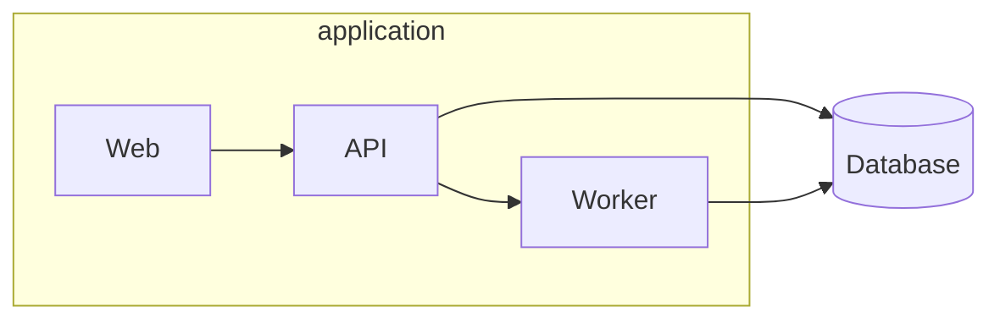
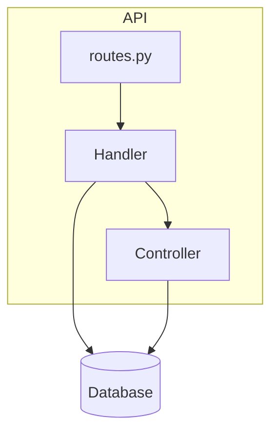
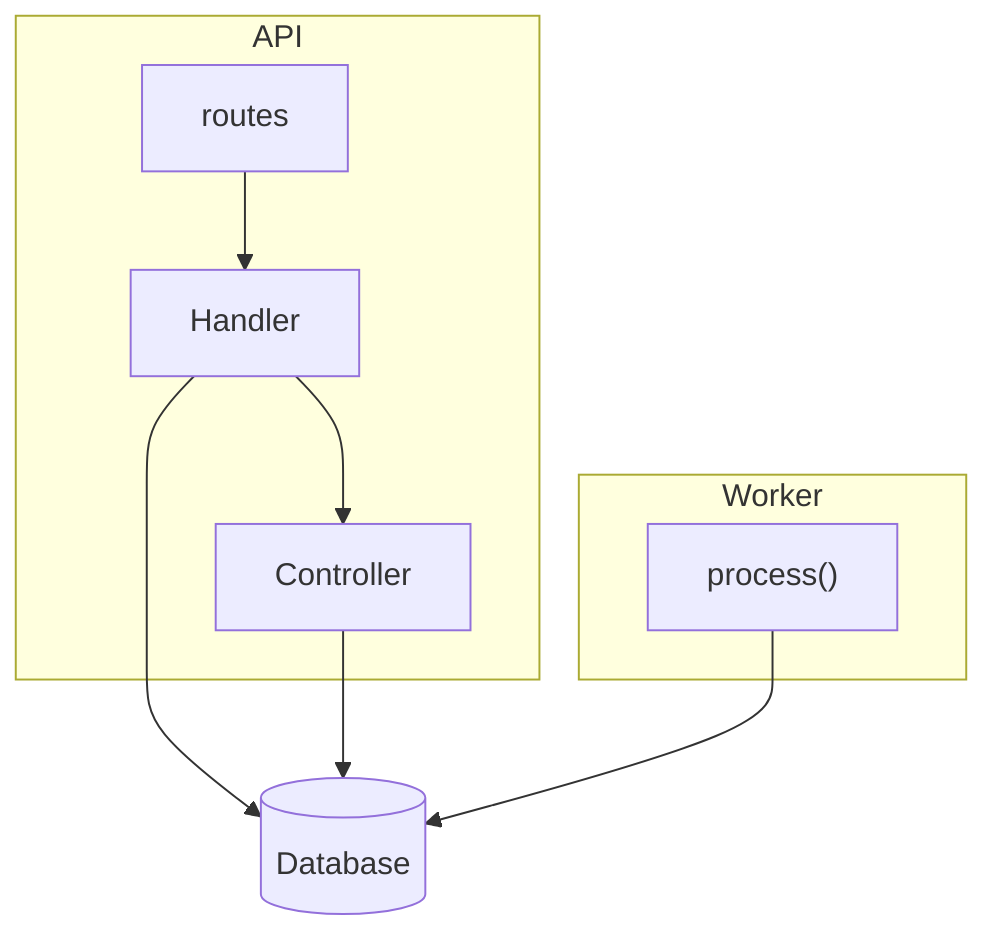

# Document project architecture

Standalone walkthrough of an application. Do not start with a fully detailed map of the whole app.

This skill owns **what to show and in what order**. Draw with Mermaid `flowchart` (fenced `mermaid` blocks) using the rules below — do not depend on another skill.

## Source pass (once)

Before the first diagram, read the repo:

1. List top-level packages, services (compose/processes), and databases — not from memory.
2. Name **main modules** (imported by others, or owners of a service). Cap ~8; fold the rest as `other["… +N modules"]`.
3. Record calls between modules and which modules talk to a DB.

Omit unknown facts, or mark `%% inferred`.

## Visual language (this skill only)

| Thing | Notation |
| --- | --- |
| Module | `subgraph mod_id [Label]` … `end` |
| Class / file | `id[Name]` |
| Function | `id["name()"]` |
| Database | `id[(Name)]` |
| Calls | `-->` |
| Depends | `-.->` |
| Contains | inner nodes inside the module subgraph |

Ids: letters, digits, underscore — no spaces or dashes. Quote labels that contain `() / :`. Containment `TB`, peer calls `LR`. Color by role with `classDef` (light fill, dark stroke; distinct processes get distinct classes; DB/model use a store class; apply to subgraph **and** inner nodes). No classes or functions on Pass 1.

## Pass 1 — simplified overview

**Question:** What are the main modules and how do they connect?

- One node per main module. No classes, no functions, no private files.
- Edges: module→module calls, module→database.
- ≤ 10 nodes.
- Caption: map of the app, not internals.

Stop unless the user asked for the full walkthrough or the next module.

## Pass 2 — one diagram per module

**Question:** What is inside this module, and what does it call?

Never put two modules' internals on one Pass 2 diagram.

- Subgraph = this module.
- Nodes = public classes and functions other modules call.
- Other modules and DBs = **external** boxes, not exploded.
- ≤ 15 nodes. Drop private helpers.
- Default `flowchart`. If this module is mostly types, `classDiagram` with one `namespace`. If one request path, `sequenceDiagram`. If this module's tables, `erDiagram`.

Follow overview order. Large sets: one module per message; otherwise several Pass 2 fences in one reply.

## Pass 3 — grouped detail of the whole app

**Question:** How does the app work in detail, with module boundaries still visible?

Only after Pass 1 and Pass 2.

- **One subgraph per overview module** — those rectangles *are* the structure.
- Inside: the same public components from Pass 2, not a new explosion of helpers.
- Cross-subgraph edges for calls. Shared DBs outside, or in `subgraph store`.
- ≤ 25 nodes. If over cap, drop the least-connected internals; **do not ungroup**.
- `TB` inside a module; `LR` between modules when it stays readable.

Pass 3 is Pass 2 laid on one canvas, grouped — not every file in the repo.

## Do not

- Do not emit Pass 3 (or a Pass-3-shaped picture) first.
- Do not put functions on the overview.
- Do not document module B internals before module B has its own Pass 2 diagram.
- Do not flatten Pass 3.

## Output

Label each fence with the pass (`Pass 1 — overview`, `Pass 2 — <module>`, `Pass 3 — detail`).

Persist only if asked. When writing a new file:

1. If the user already named a path, use it.
2. Else if a `docs/` directory exists at the repo root, use that as the default (`docs/architecture/overview.md`, `docs/architecture/modules/<module>.md`, `docs/architecture/detail.md`).
3. Else ask where to put the files before creating a folder.
