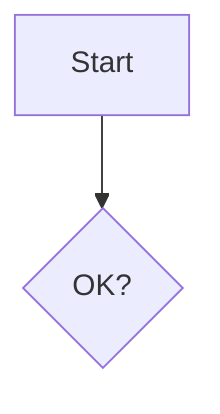

# Advanced features

Apply this file when the user asks for ELK, `handDrawn`, dark theme, or custom `themeVariables`.

Default diagrams: classic look, dagre, **role colors via `classDef`**. Color palette and readable layout live in [readability.md](readability.md) — always use that, even when this file is not needed.

Dense-flowchart front matter (`curve: basis`, spacing) is allowed without asking; it is specified in readability.md. Do not add `layout: elk` or `handDrawn` unless asked.

## Comments

`%%` starts a line comment. Use them to explain non-obvious edges, not to narrate the diagram.

## Front matter config (preferred)



| Key | Values | Notes |
| --- | --- | --- |
| `theme` | `default`, `forest`, `dark`, `neutral`, `base` | `dark` for dark-only docs |
| `look` | `classic`, `handDrawn` | Sketch style is optional |
| `layout` | `dagre`, `elk` | ELK for dense graphs; dagre is safer on GitHub |

## Init directive (legacy, still valid)

```
%%{init: {"theme": "neutral", "look": "classic", "layout": "dagre"}}%%
```

## Theme variables

Only when a custom palette is required:

```
---
config:
  theme: base
  themeVariables:
    primaryColor: "#e8f1ff"
    primaryTextColor: "#1a1a1a"
    primaryBorderColor: "#3b6ea5"
    lineColor: "#5c5c5c"
    fontFamily: "Inter, sans-serif"
---
```

Do not invent one-off hex per node. Roles and the default palette: [readability.md](readability.md).

## classDef (flowcharts / class diagrams)

Required on flowcharts. Apply the class to **subgraph ids and inner nodes**.

```
classDef store fill:#E8F5E9,stroke:#2E7D32,color:#1B5E20
class db,model store
```

`style NodeId fill:#fff` scatters colors — skip. `linkStyle 0 …` is the nth edge (0-based) and breaks when edges move — skip.

## Titles and wrapping

- Sequence: first `Note over` can state the scenario
- Prefer `<br>` in labels over huge single-line names: `A["FastAPI<br/>:8000"]`

## GitHub vs Live Editor

Safe in GitHub Markdown: flowchart, sequence, class, er, state, gantt, pie, gitGraph.

Verify in [Mermaid Live](https://mermaid.live) before committing: `architecture-beta`, ELK layout, `handDrawn`, custom `themeVariables`.
