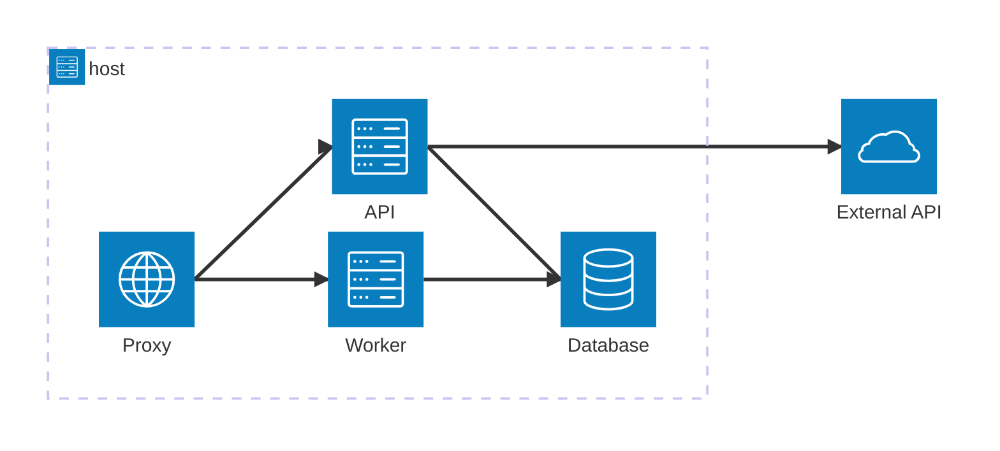
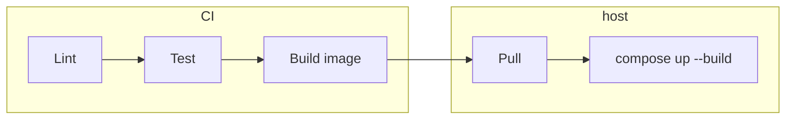

# Architecture diagrams

Use `architecture-beta` only for **runtime** processes and DBs, and only when the user wants that type. Default for repo wiring is `flowchart`. Do not put classes or functions here. GitHub often skips `architecture-beta` — fall back to `flowchart` + `[(db)]`.



## Building blocks

Declare identifiers before using them on edges.

```
group id(icon)[Label]
service id(icon)[Label]
service id(icon)[Label] in groupId
junction id
```

Icons go in `()`; labels in `[]`. Common icons: `server`, `database`, `cloud`, `disk`, `internet`. Unknown icons may render as a generic box — prefer ones listed in [Mermaid architecture docs](https://mermaid.js.org/syntax/architecture.html).

## Edges

Format: `fromId:PORT -- PORT:toId` or `-->` for arrows.

Ports: `L` left, `R` right, `T` top, `B` bottom.

```
api:R --> L:db
api:B -- T:worker
```

Junctions split or join edges without a service box:

```
junction j1
proxy:R -- L:j1
j1:R -- L:api
j1:R -- L:worker
```

## When to use vs a flowchart

| Goal | Type |
| --- | --- |
| Which processes exist and which DB they use | `architecture-beta` |
| Service contains modules; modules call each other | `flowchart` with subgraphs |
| CI/CD or pipeline steps | `flowchart` with subgraphs per stage |

For pipelines, a flowchart is usually clearer than architecture-beta:


