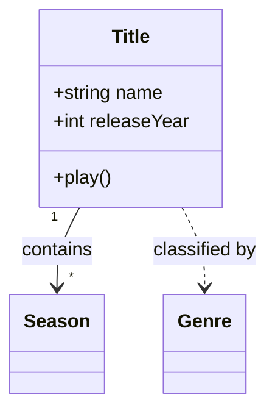
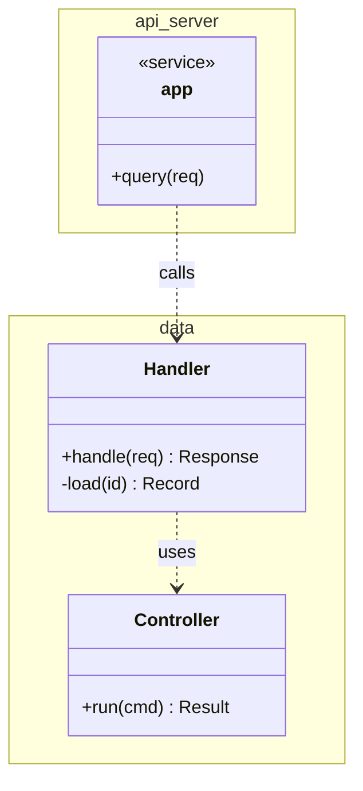

# Class diagrams

Use `classDiagram` for domain models and for **repository structure**: a module contains classes and functions; a class exposes methods; a service or module depends on another.



## Relationships

| Syntax | Meaning |
| --- | --- |
| `<\|--` / `--\|>` | Inheritance |
| `*--` / `--*` | Composition |
| `o--` / `--o` | Aggregation |
| `-->` / `<--` | Association |
| `..>` / `<..` | Dependency |
| `..|>` / `<|..` | Realization |
| `--` | Solid link |
| `..` | Dashed link |

Label an edge: `A --> B : creates`.

## Multiplicity

Put quotes on either side of the connector:

```
Customer "1" --> "*" Ticket
Student "1" --> "1..*" Course
```

Common values: `1`, `0..1`, `1..*`, `*`, `n`.

## Members and visibility

Two equivalent member styles:

```
class Shape {
    +int x
    +int y
    +draw() bool
}

Shape : +int x
Shape : +draw()
```

| Prefix | Visibility |
| --- | --- |
| `+` | public |
| `-` | private |
| `#` | protected |
| `~` | package |

Classifiers: `<<interface>>`, `<<abstract>>`, `<<enumeration>>`, `<<module>>`, `<<service>>`, `<<database>>`.

```
class Drawable {
    <<interface>>
    +draw()
}
```

## Structure

- `namespace App.Domain { ... }` to group classes **by module / package / file**
- `note for Title "Played by the media client"`
- `class Title:::highlight` plus `classDef` from [advanced-features.md](advanced-features.md)
- Quote names with spaces: `class "Line Item"`

Keep attributes that exist in code; omit getters that add no information.

## Modules, classes, functions



- **Module** → `namespace` around its types. Free functions → one `<<module>>` class named after the file, methods = functions.
- **Class** → `class` with real attributes and methods.
- **Service** (application process that hosts modules) → `<<service>>` at this level only if you are showing code types. For process/DB topology use `flowchart` or `architecture-beta`.
- **Contains** → `namespace` or composition `*--`. **Calls** → `..>` or `-->`.
- Do not list every private helper; show the functions other modules actually call.
