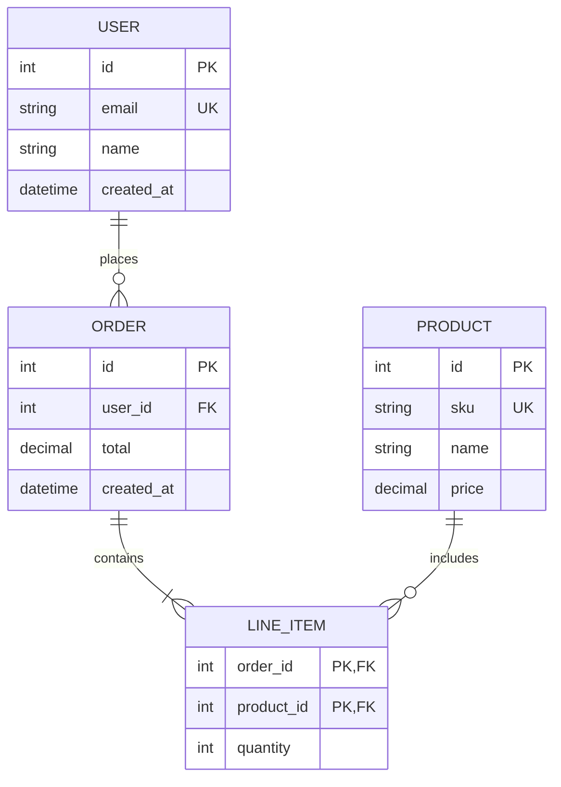

# Entity relationship diagrams

Use `erDiagram` for database schemas: tables, keys, and cardinality.



## Cardinality

Place identifiers on both sides of the relationship.

| Symbol | Meaning |
| --- | --- |
| `\|\|` | Exactly one |
| `\|o` / `o\|` | Zero or one |
| `}o` / `o{` | Zero or more |
| `}\|` / `\|{` | One or more |

Text forms also work: `only one to zero or more`, `one or more`, `zero or one`.

Identify vs non-identifying:

- identifying: `||--|{` (solid) — child identity includes the parent key
- non-identifying: `||..o{` (dotted) — child has its own PK

Always label the verb: `USER ||--o{ ORDER : places`.

## Attributes

```
ENTITY {
    type name KEY "comment"
}
```

- Types: `int`, `string`, `string(99)`, `decimal`, `datetime`, `boolean`, `string[]`
- Keys: `PK`, `FK`, `UK` — combine with commas (`PK, FK`)
- Comments are double-quoted; no nested quotes, no markdown

Use table and column names as they exist in SQL. Show join tables explicitly instead of hiding M:N as a magic line.
