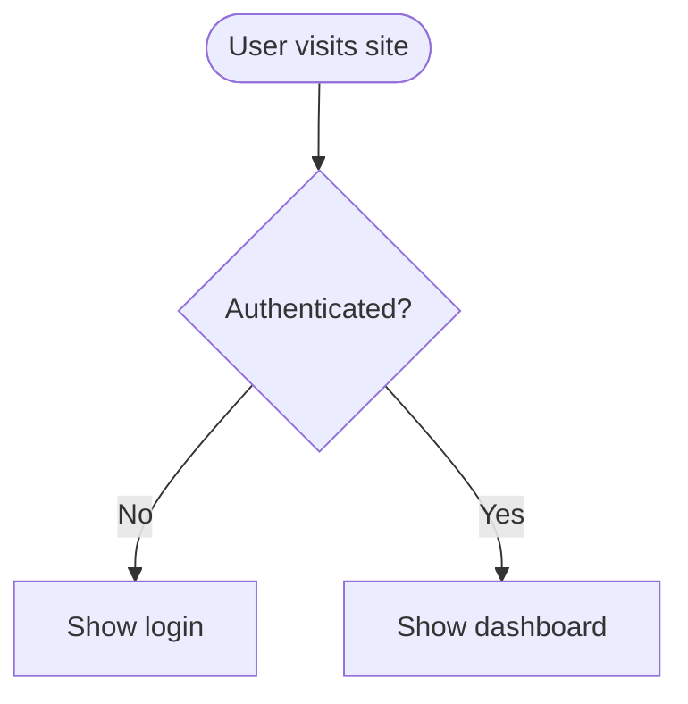
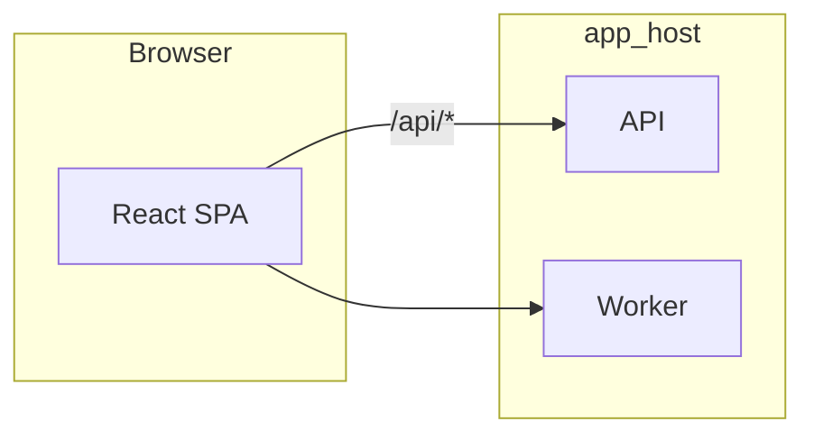
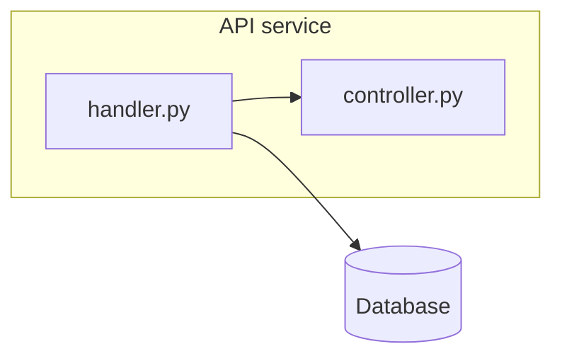

# Flowcharts

Use `flowchart` for journeys, processes, pipelines, and **repository wiring**: a service subgraph contains modules; modules contain classes/functions; cylinders are databases those services query. Prefer `flowchart` over legacy `graph`.



## Direction

`TD` / `TB` top-down, `BT` bottom-up, `LR` left-right, `RL` right-left.

## Node shapes

| Syntax | Shape | Typical use |
| --- | --- | --- |
| `id[text]` | Rectangle | Step / screen |
| `id(text)` | Rounded | Process |
| `id([text])` | Stadium | Start / end |
| `id[[text]]` | Subroutine | Reusable call |
| `id[(text)]` | Cylinder | Database |
| `id((text))` | Circle | Connector |
| `id{text}` | Diamond | Decision |
| `id{{text}}` | Hexagon | Event / prepare |
| `id[/text/]` | Parallelogram | Input / output |
| `id>text]` | Asymmetric | External |

Quote labels with punctuation: `A["POST /login"]`.

## Edges

| Syntax | Meaning |
| --- | --- |
| `-->` | Arrow |
| `---` | Line |
| `-.->` | Dotted |
| `==>` | Thick |
| `-- text -->` | Labeled |
| `A -->|Yes| B` | Decision branch |
| `A --o B` / `A --x B` | Circle / cross end |

Link length (`---->`) can nudge layout; prefer subgraphs over long chains of dashes.

## Subgraphs



Direction inside a subgraph: `direction TB` on the first line of the subgraph.

Nesting: **module** = subgraph; **class/function** = nodes inside; **database** = cylinder outside. For a whole-app detail view, one subgraph per module — that grouping is the structure. Do not flatten modules into one soup of nodes.

Do not wrap several modules in an extra parent subgraph if other islands have edges into them — Mermaid routes those arrows around the whole parent. `direction TB` inside a subgraph; outer `LR` for a call pipeline. See [readability.md](readability.md).



## Styling

Flowcharts are colored by role. Palette, `classDef` rules, and layout anti-patterns: [readability.md](readability.md). Do not emit an uncolored flowchart.

```
classDef http fill:#FFF3E0,stroke:#EF6C00,color:#E65100
classDef store fill:#E8F5E9,stroke:#2E7D32,color:#1B5E20
class api,handler http
class db store
```

Error accent only when the node is an error: `fill:#fde8e8,stroke:#c0392b`.

Comments: `%% why this edge exists`.

Do not encode every branch of a large algorithm in one chart; split by phase.
