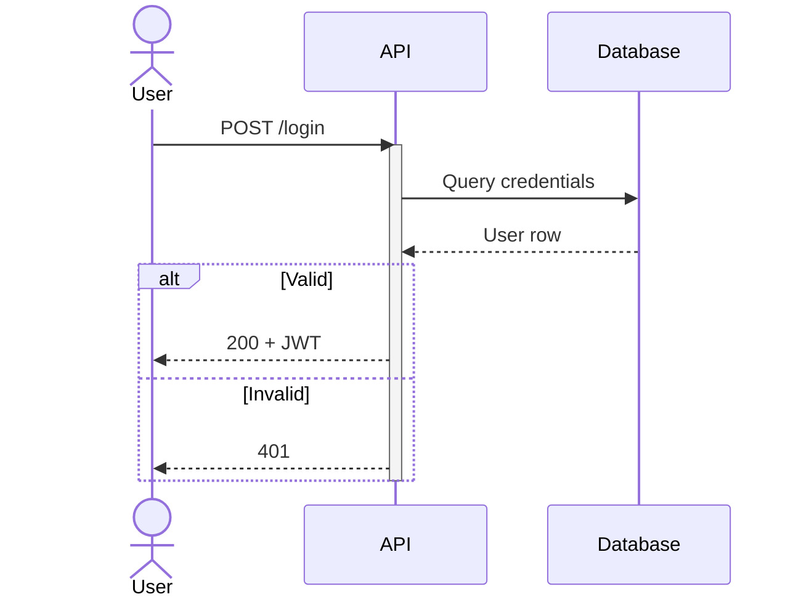

# Sequence diagrams

Use `sequenceDiagram` for API flows, auth, and any time-ordered path: caller → service → module/function → database.



## Participants

- `participant Name` — box
- `actor Name` — stick figure
- `participant API as FastAPI` — alias (`API` in messages, label shown)
- Declare in left-to-right order; first mentioned is leftmost if undeclared

## Messages

| Arrow | Meaning |
| --- | --- |
| `->` | Solid, no arrowhead |
| `->>` | Solid, filled arrow (sync / request) |
| `-->` | Dotted, no arrowhead |
| `-->>` | Dotted, filled arrow (response) |
| `-x` / `--x` | Failed / lost |
| `-)` / `--)` | Async / open arrow |
| `<<->>` / `<<-->>` | Bidirectional |

Activation: suffix `+` / `-` on the arrow, or `activate X` / `deactivate X`.

```
API->>+DB: query
DB-->>-API: rows
```

## Control blocks

```
alt Condition A
    A->>B: path A
else Condition B
    A->>B: path B
end

opt Optional step
    A->>B: maybe
end

loop Every page
    A->>B: fetch
end

par Parallel
    A->>B: one
and
    A->>C: two
end

critical Mutex
    A->>B: locked work
    option Conflict
        B-->>A: busy
    end
end

break On error
    B-->>A: fail
end
```

## Notes and grouping

```
Note left of API: App-local session
Note right of User: Browser cookie
Note over API,DB: Shared database
rect rgb(240, 248, 255)
    API->>DB: scoped query
end
```

`autonumber` numbers messages. `box` groups participants:

```
box rgba(200,220,255,0.3) Backend
    participant API
    participant DB
end
```

Prefer real HTTP methods and status codes. Show failure paths with `alt`/`else`, not only the happy path.
